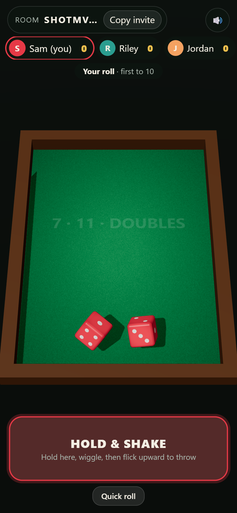
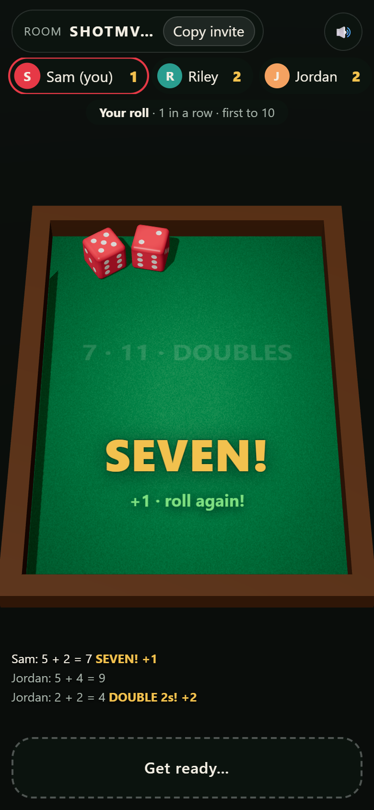
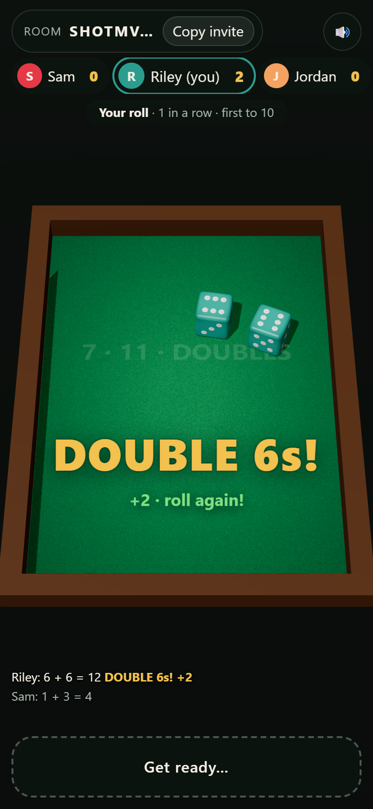
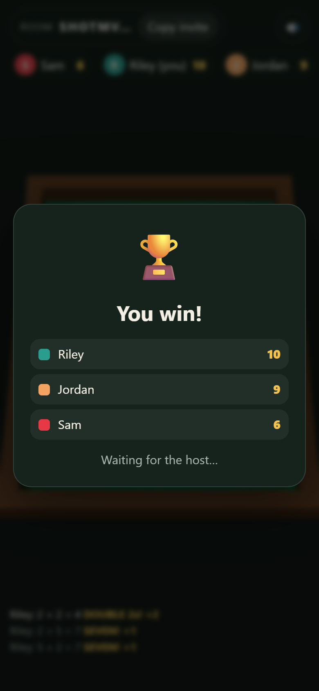

# 7, 11, Doubles

A multiplayer two-dice game with 3D dice that you **shake and throw with your phone**. It runs as a **Discord Activity** or standalone at **https://dice.housetandem.com**.

- Roll **7** or **11** for **+1**. Roll **doubles** for **+2**. Hit and you roll again; miss and the dice pass on.
- First to the target (5, 10 or 21) wins.

## Play

| | Link |
|---|---|
| **In your browser** | https://dice.housetandem.com |
| **In Discord** (opens the Activity) | https://discord.com/activities/1560074262008700930 |
| **Add it to a Discord server** | https://discord.com/oauth2/authorize?client_id=1560074262008700930 |

To launch the Discord Activity, the app must be installed in the server you're in. You can add tags to the Activity link to see where players come from: `?referrer_id=<a Discord user ID>` or `?custom_id=<label>` (see [Discord's growth and referrals guide](https://docs.discord.com/developers/activities/development-guides/growth-and-referrals)).

Built with Three.js, cannon-es, the DeviceMotion API, PeerJS (WebRTC) and a Cloudflare Worker with a Durable Object relay. See [PLAN.md](PLAN.md) for the full design.

## Screenshots

| Hold & shake | Seven | Doubles | Winner |
|---|---|---|---|
|  |  |  |  |

More in the [gallery](https://dice.housetandem.com/screenshots/). To regenerate them, run `node scripts/screenshots.mjs`. It plays real games on the live site (no rigged dice) and captures each outcome as it happens.

## How to play

1. Open the site. It creates a room and puts its code in the URL. Use **Copy invite** to share it.
2. The first player in the room is the host. The host picks the target and presses **Start game**.
3. On your turn, **press and hold the cup**, shake your phone, then flick it forward or let go to throw. On iPhone, tap **Enable shake to roll** first.
4. **No motion sensors?** In Discord, on a desktop, or on a phone that won't share its motion, the cup is replaced by **📱 Shake with your phone**. See below.
5. **Quick roll** is always there as an alternative.

## 📱 Shaker remote

Discord doesn't let Activities read a phone's motion sensors. Its Activity iframe doesn't delegate the `accelerometer` and `gyroscope` [Permissions Policy](https://developer.mozilla.org/en-US/docs/Web/HTTP/Guides/Permissions_Policy) features, and a frame can't turn them back on. So any phone can be the dice cup for a seat at the table:

1. Tap **📱** (top right, or **Roll with your phone** in the lobby). The table shows a QR code and the full link.
2. Scan it with a phone's camera and tap **Tap to connect**. The phone opens in its own browser, where motion works.
3. On your turn, shake the phone and flick it. The dice roll on the table, and the phone shows the result once they land.

Notes:
- Inside Discord on a phone, **Open on this phone** opens the link in that phone's browser.
- A 📱 badge next to your name shows everyone when your phone is connected.
- **New link** makes the old one stop working, and **Unpair** stops using the phone.
- Anyone with your link can throw for you, so don't show the code on a stream.

The full design is in [SHAKER-REMOTE.md](SHAKER-REMOTE.md).

## 🎯 Throw calibration (optional)

Anywhere motion works (a phone playing directly, or the phone remote), tap **🎯** to teach the game your style: one quick shake, then three throws straight at the table.

- **Direction:** whatever way you threw becomes straight ahead. Push the phone away, flick it up the screen, or anything in between; left and right are measured from that direction.
- **Strength:** a flick as gentle as your practice throws counts, and your usual throw reads as a strong throw.
- **Shaking:** your normal shaking reads as full shaking.
- If one practice throw goes a clearly different way, you're asked to redo it.
- It's saved in that phone's browser. **Reset to default** undoes it.

It only changes how the dice tumble. Results are still picked at random by the host.

## Playing on phones

DeviceMotion, WebCrypto and WebRTC all need **HTTPS**, so test on phones with the deployed site (or an HTTPS tunnel), not `http://<lan-ip>:5173`.

## Development

```bash
npm install
npm test              # unit tests (Vitest)
npm run typecheck     # app + worker
npm run build         # type-check + Vite build to dist/
npm run preview       # build, then serve app + Worker + Durable Object at http://127.0.0.1:8787
```

`npm run dev` starts Vite with hot reload. It proxies `/api` to `wrangler dev` on :8787, so run `npx wrangler dev` alongside it when you need the relay or `/api/*`.

### End-to-end test

With `npm run preview` running:

```bash
node scripts/e2e.mjs http://127.0.0.1:8787 relay 3    # or: peerjs 3
```

This drives several headless Chrome players through a full match, with a host disconnect partway through. It checks that every player saw identical rolls and scores, and saves screenshots to `scripts/out/`.

```bash
node scripts/e2e-remote.mjs http://127.0.0.1:8787 relay   # or: peerjs
```

This tests the shaker remote:
- A phone page opened before anyone is at the table never becomes host.
- A player pairs a phone from the lobby, and the phone throws with synthetic shake-and-flick motion events.
- The host leaves mid-game and the phone keeps working with the new host.
- **New link** locks out the old phone.

```bash
node scripts/e2e-deploy.mjs http://127.0.0.1:8787
```

This checks that a page caught mid-deploy recovers. For a few seconds after `npm run deploy`, a page can arrive before its script has spread across Cloudflare. `public/boot-guard.js` then shows "Loading the latest version…" and reloads, waiting 1, 2 and 4 seconds. After three tries it offers a Reload button. The test fakes failed script loads to exercise this, and checks that a missing file returns a 404 instead of the game page.

Add `&nomotion` to any table URL to see the no-motion (Discord or desktop) layout on a phone.

### Choosing a transport

| URL | Transport |
|---|---|
| `?room=ABC123` | PeerJS / WebRTC (standalone default) |
| `?room=ABC123&t=relay` | WebSocket relay via Durable Object (Discord default) |

Everyone in a room must use the same transport. Invite links carry the choice. If WebRTC can't connect, the error banner links to the relay version of the room.

Add `&debug` to expose `window.dice` and turn on PeerJS logging.

## Deploying to Cloudflare

The Worker serves the static build, `/api/*` and the relay. It's live at **https://dice.housetandem.com**, and also at https://discord-activity-dice.pete-872.workers.dev.

`wrangler.jsonc` binds it to the custom domain `dice.housetandem.com`. Wrangler creates the DNS record on deploy, so the `housetandem.com` zone must be on the same Cloudflare account.

```bash
npx wrangler login
npm run deploy
```

Optional secrets:

```bash
npx wrangler secret put DISCORD_CLIENT_SECRET   # required for Discord
npx wrangler secret put TURN_KEY_ID             # Cloudflare Realtime TURN, improves WebRTC behind strict NATs
npx wrangler secret put TURN_KEY_API_TOKEN
```

## Discord Activity setup

1. Create an application at https://discord.com/developers/applications.
2. Under **Activities → Settings**, enable Activities.
3. Under **Activities → URL Mappings**, add:

   | Prefix | Target |
   |---|---|
   | `/` | `dice.housetandem.com` |
   | `/peerjs` | `0.peerjs.com` (only needed if you force `t=peerjs`) |

4. Under **OAuth2 → Redirects**, add **exactly one** redirect, e.g. `https://127.0.0.1`. The SDK never visits it, but Discord fails with `Missing "redirect_uri"` if there are none or more than one.
5. Put the public application ID (this project: `1560074262008700930`) in two places:
   - `wrangler.jsonc` → `vars.DISCORD_CLIENT_ID`
   - `.env.production` → `VITE_DISCORD_CLIENT_ID=<id>` (read at build time; committed, as it holds no secrets)
6. Set the secret with `npx wrangler secret put DISCORD_CLIENT_SECRET`, then run `npm run deploy`.
7. In the developer portal's **General Information**, set:
   - **Terms of Service URL:** https://dice.housetandem.com/terms
   - **Privacy Policy URL:** https://dice.housetandem.com/privacy
8. Under **Installation**, enable **Guild Install** with the `applications.commands` scope, and under **Activities → Settings → Supported Platforms** tick iOS and Android. Then open the install link to add the app to a server.
9. Launch the Activity from a voice channel. Everyone in the same Activity instance joins the same table automatically.

## Project layout

```
src/
  main.ts                 boot: identity, transport, wiring, render loop
  ui.ts, style.css        DOM overlay (lobby, scores, callouts, cup)
  audio.ts                synthesised rattle/impact sounds
  game/                   rules, pure game reducer, host authority
  dice/                   face math, physics sim + recording, roll planning, playback
  input/                  device-motion shake/flick detection, pointer fallback, throw normalisation
  net/                    protocol, transports (PeerJS, relay), room coordination
  platform/               environment, identity/rooms, Discord SDK, motion detection
  remote/                 the 📱 shaker remote page (remote.html, served at /remote)
  render/                 Three.js table and dice
worker/src/index.ts       Worker: assets, /api/token, /api/ice, RelayRoom Durable Object
worker/src/roomTicket.ts  Discord room names and join tickets
test/                     Vitest unit tests
scripts/e2e.mjs           Playwright multi-player smoke test
scripts/e2e-remote.mjs    Playwright shaker-remote test
```
